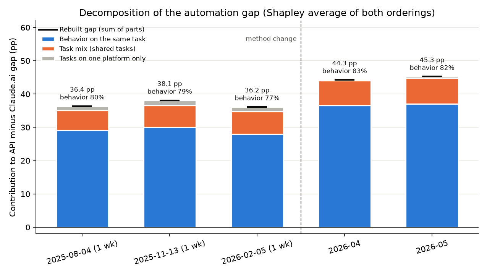

# NOTES

Research question: Do businesses (API usage) show a higher automation share than individual consumers (Claude.ai usage) on the same tasks, and has that gap changed across the Anthropic Economic Index's releases?

Scripts behind everything below (run from the repo root):
- `src/fetch.py`: downloads every file at a pinned commit and checks checksums.
- `src/releases.py`: shared release definitions and metric logic.
- `src/inventory.py`: Step 4 inventory, claimed vs. actual.
- `src/raw_examples.py`: Step 5 slices.
- `src/exploratory.py`: Step 6 figures.

## 1. Provenance

**Source:** Anthropic Economic Index, https://huggingface.co/datasets/Anthropic/EconomicIndex. This is the primary source: Anthropic's own Hugging Face dataset.

**Pinned version:** commit `4e5f69fab13a9c3f7d0dcc31a6f893a9818738f6` (2026-09-30). This is the latest commit before the files were downloaded. `src/fetch.py` downloads with `revision=` set to this commit and checks every CSV's sha256. All 8 local files match it byte for byte.

**Download dates:**
- 2026-09-13: first download (2025-09-15 release, enriched Claude.ai file, no longer used).
- 2026-10-05: all 8 CSVs below.
- 2026-10-25: documentation and O*NET reference file, via `src/fetch.py`.

**License:** data released under CC-BY; code released under the MIT License.

**Files** (permanent `/resolve/<commit>/` links):

| Release | Description (from the dataset README) | Files |
|:--|:--|:--|
| 2025-09-15 | Geographic and first-party API data using Sonnet 4 | [aei_raw_1p_api_2025-08-04_to_2025-08-11.csv](https://huggingface.co/datasets/Anthropic/EconomicIndex/resolve/4e5f69fab13a9c3f7d0dcc31a6f893a9818738f6/release_2025_09_15/data/intermediate/aei_raw_1p_api_2025-08-04_to_2025-08-11.csv), [aei_raw_claude_ai_2025-08-04_to_2025-08-11.csv](https://huggingface.co/datasets/Anthropic/EconomicIndex/resolve/4e5f69fab13a9c3f7d0dcc31a6f893a9818738f6/release_2025_09_15/data/intermediate/aei_raw_claude_ai_2025-08-04_to_2025-08-11.csv) |
| 2026-01-15 | Economic primitives and Sonnet 4.5 | [aei_raw_1p_api_2025-11-13_to_2025-11-20.csv](https://huggingface.co/datasets/Anthropic/EconomicIndex/resolve/4e5f69fab13a9c3f7d0dcc31a6f893a9818738f6/release_2026_01_15/data/intermediate/aei_raw_1p_api_2025-11-13_to_2025-11-20.csv), [aei_raw_claude_ai_2025-11-13_to_2025-11-20.csv](https://huggingface.co/datasets/Anthropic/EconomicIndex/resolve/4e5f69fab13a9c3f7d0dcc31a6f893a9818738f6/release_2026_01_15/data/intermediate/aei_raw_claude_ai_2025-11-13_to_2025-11-20.csv) |
| 2026-03-24 | Opus 4.5/4.6 and learning curves | [aei_raw_1p_api_2026-02-05_to_2026-02-12.csv](https://huggingface.co/datasets/Anthropic/EconomicIndex/resolve/4e5f69fab13a9c3f7d0dcc31a6f893a9818738f6/release_2026_03_24/data/aei_raw_1p_api_2026-02-05_to_2026-02-12.csv), [aei_raw_claude_ai_2026-02-05_to_2026-02-12.csv](https://huggingface.co/datasets/Anthropic/EconomicIndex/resolve/4e5f69fab13a9c3f7d0dcc31a6f893a9818738f6/release_2026_03_24/data/aei_raw_claude_ai_2026-02-05_to_2026-02-12.csv) |
| 2026-06-26 | Artifacts and monthly aggregates | [aei_1p_api_2026-06-26.csv](https://huggingface.co/datasets/Anthropic/EconomicIndex/resolve/4e5f69fab13a9c3f7d0dcc31a6f893a9818738f6/release_2026_06_26/data/aei_1p_api_2026-06-26.csv), [aei_claude_ai_2026-06-26.csv](https://huggingface.co/datasets/Anthropic/EconomicIndex/resolve/4e5f69fab13a9c3f7d0dcc31a6f893a9818738f6/release_2026_06_26/data/aei_claude_ai_2026-06-26.csv) |

Also fetched:
- each release's `data_documentation.md`;
- `release_2025_09_15/data/input/onet_task_statements_raw.xlsx`, which maps each task to its O*NET-SOC code and is used for the task mix.

Releases 1 and 2 (2025-02-10, 2025-03-27) are Claude.ai-only. They can't show an API vs. Claude.ai gap, so they are not used.

**Citations:**
- 2025-09-15: @online{appelmccrorytamkin2025geoapi, author = {Ruth Appel and Peter McCrory and Alex Tamkin and Michael Stern and Miles McCain and Tyler Neylon}, title = {Anthropic Economic Index Report: Uneven Geographic and Enterprise AI Adoption}, date = {2025-09-15}, year = {2025}, url = {www.anthropic.com/research/anthropic-economic-index-september-2025-report}, }
- 2026-01-15: @online{anthropic2026aeiv4, author = {Ruth Appel and Maxim Massenkoff and Peter McCrory and Miles McCain and Ryan Heller and Tyler Neylon and Alex Tamkin}, title = {Anthropic Economic Index report: economic primitives}, date = {2026-01-15}, year = {2026}, url = {https://www.anthropic.com/research/anthropic-economic-index-january-2026-report}, }
- 2026-03-24: @online{anthropic2026aeiv5, author = {Maxim Massenkoff and Eva Lyubich and Peter McCrory and Ruth Appel and Ryan Heller}, title = {Anthropic Economic Index report: Learning curves}, date = {2026-03-24}, year = {2026}, url = {https://www.anthropic.com/research/economic-index-march-2026-report}, }
- 2026-06-26: @online{anthropic2026aeiv6, author = {Maxim Massenkoff and Eva Lyubich and Szymon Sacher and Zoe Hitzig and Shaoyi Zhang and Ryan Heller and Peter McCrory}, title = {Anthropic Economic Index report: Cadences}, date = {2026-06-26}, year = {2026}, url = {https://www.anthropic.com/research/economic-index-june-2026-report}, }

## 2. Dataset summary

### Collection
Each release samples Claude.ai conversations and first-party (1P) API traffic. It analyses them with Clio, an automated, privacy-preserving framework in which Claude reads the transcripts and no human does. Each conversation is mapped to a task in the U.S. Department of Labor's O*NET catalog.

- **2025-09-15:** one week, 2025-08-04 to 2025-08-11.
  - Claude.ai: 1M Free and Pro conversations.
  - API: 1M transcripts sampled from a pool of 1P API customers that makes up roughly half of API usage.
- **2026-01-15:** one week, 2025-11-13 to 2025-11-20. 1M conversations and 1M API transcripts.
- **2026-03-24:** one week, 2026-02-05 to 2026-02-12. 1M conversations from each platform. The API sample includes Claude Code (report footnote 2).
- **2026-06-26:** calendar-month aggregates for April and May 2026.
  - Conversations are sampled continuously every day; the report contrasts this with the earlier seven-day samples.
  - Claude.ai covers chat and Cowork (Free, Pro, Max).
  - The API file excludes Claude Code (documentation, Source Files table).

### Unit of observation
- **Weekly releases** (2025-09-15 to 2026-03-24, "raw" schema): one row = one metric (`variable`) for one facet value (`cluster_name`) in one geography, for the sampled week.
  - Underneath, a Claude.ai record is a conversation. An API record is a single prompt–response pair, so API "conversations" are not full multi-turn trajectories.
  - The API is global only. Claude.ai is global / country / US state (2025-09-15) or global / country / country-state (later).
- **Monthly release** (2026-06-26, "monthly" schema): one row = one metric (`metric_id`) for one geography (`geo_id`) × one category node (`category_name`, `node_name` / `node_external_id`, `hierarchy_level`) × one month (`date_start`).
  - Collaboration patterns are their own metric_ids.
  - Only shares are published, no counts.

### Labels
Clio assigns each conversation one of five collaboration patterns, or "none":
- **Automation:** directive, feedback loop.
- **Augmentation:** task iteration, learning, validation.

The classification was hand-validated only in the original paper: 90.7% of 150 conversations were judged to have their best label (arXiv 2503.04761, Appendix C "Human Validation", p.21). That validation applies to the original setup. The classifying model has changed since:
- V2 used Sonnet 3.7, and V3 (2025-09-15) used Sonnet 4 (2025-09-15 report).
- 2026-01-15 used Sonnet 4.5. That report's footnote 7 says model changes affect classifications, though the effects "tend to be modest".
- The 2026-03-24 and 2026-06-26 reports don't name the classifying model. 2026-06-26 adds a new artifact classifier.

No validation has been published for later releases or for API transcripts specifically.

### Headline numbers (verification targets)
- **2025-09-15:**
  - ~1M Claude.ai conversations and ~1M API transcripts.
  - 19,530 O*NET tasks in the taxonomy (arXiv 2503.04761, p.18, Figure 9).
  - Claude.ai: 49.1% automation vs. 47.0% augmentation. API: 77% automation, 12% augmentation.
  - Claude.ai directive share rose from 27% to 39% (arXiv 2511.15080).
- **2026-01-15:**
  - Claude.ai: augmented "jumped 5pp to 52%"; automated "fell 4pp to 45%"; directive "fell 7pp to 32%".
  - API: about three-quarters automation.
  - Top 10 tasks: 24% of Claude.ai usage, 32% of API usage. Over 3,000 tasks on Claude.ai.
- **2026-03-24:**
  - Claude.ai augmentation "increased slightly". API automation "decreased sharply".
  - Top 10 tasks: 24% → 19% on Claude.ai; 33% on the API, "up from 28%".
- **2026-06-26:** no automation headline. Personal use is ~35% of chat and Cowork conversations on weekdays and just under 50% on weekends.

## 3. Harmonization table

The three weekly releases form one regime and the monthly release another. Compare within a regime, and treat any jump at the 2026-06-26 boundary as possibly caused by the change in method (see §7).

| Release | Sample | Claude.ai scope | API scope | Classifier model | O*NET version | Format |
|:--|:--|:--|:--|:--|:--|:--|
| 2025-09-15 | 1 week, Aug 2025 | Free, Pro | Customer pool (~half of API use); Claude Code not stated | Sonnet 4 | 2010 (per 2026-03-24 fn 3) | raw, counts + shares |
| 2026-01-15 | 1 week, Nov 2025 | Free, Pro, Max per report; file says "Free and Pro" | Claude Code not stated | Sonnet 4.5 | 2010 (per 2026-03-24 fn 3) | raw, counts + shares; adds economic primitives (ai_autonomy etc.) |
| 2026-03-24 | 1 week, Feb 2026 | Free, Pro, Max | **Includes Claude Code** | not stated | **2019** O*NET-SOC | raw, counts + shares |
| 2026-06-26 | Monthly, Apr + May 2026 (daily sampling) | Chat + **Cowork**, Free, Pro, Max | **Excludes Claude Code** | not stated; new artifact classifier | Task IDs match the 2010 reference for only ~78% of tasks | monthly, shares only |

Automation metric used everywhere: (directive + feedback loop) / (all five patterns), recomputed from the patterns in every release ("classified" definition). The reports' headline numbers use the "all conversations" definition: (directive + feedback loop) / all conversations, including "none". The two are not mixed.

### Harmonized task panel (`src/harmonize.py`)
`src/harmonize.py` turns all four releases into one dataset, `data/processed/task_panel.csv` (git-ignored; rebuild with the script). It has one row per task × platform × period: **21,037 rows**. Every variable has the same name, definition and unit in both formats. This is the dataset the regression uses.

**Harmonization decisions:**
- **Task key:** the task statement, lower-cased with whitespace collapsed.
  - Weekly files identify tasks only by statement; the monthly file by Task ID.
  - Only ~78% of monthly IDs exist in the 2010 O*NET reference, but statements can be matched in either format.
  - Where a statement appears under two Task IDs in one period, the higher-usage row is kept.
- **Collaboration patterns:** each of the five as a % of the task's *classified* conversations (none and not_classified excluded).
  - automation_pct = directive + feedback loop.
  - none_pct is kept separately, as a % of conversations including none.
- **Major group:** from the O*NET reference by statement. A statement used in several occupations gets its most common major group. Monthly tasks whose statement doesn't match fall back to their Task ID: 90% matched, 10% missing.
- **Share variables** (multitasking, human-only ability, use case): % among classified conversations for the task.
  - Weekly: recomputed from counts, excluding not_classified.
  - Monthly: as published.
- **Units:** human_only_time is in hours and human_with_ai_time in minutes. The June 2026 documentation states this; the weekly documentation gives no units, but its values are consistent with the same units.
- **Format fixes:** the `::value` suffix on task names in 2026-03-24 numeric facets is removed (§6).
- **Regime indicator:** `regime` is "weekly" for the first three releases and "monthly" for 2026-06-26.

**Variable availability** (% of rows with a value):

| Variable | Aug 2025 | Nov 2025 | Feb 2026 | Apr–May 2026 |
|:--|--:|--:|--:|--:|
| automation_pct, five patterns, none_pct | 100 | 100 | 100 | 100 |
| major_group | 100 | 100 | 100 | 90 |
| classified_n (record counts) | 100 | 100 | 100 | 0 (shares only) |
| ai_autonomy, human/ai education years, human_only_time, human_with_ai_time | **0** | 100 | 100 | 100 |
| multitasking_pct, human_only_ability_pct | **0** | 100 | 100 | 100 |
| use_case_work / personal / coursework_pct | **0** | 95–99 | 96–99 | 100 |

The task characteristics ("economic primitives") start with the 2026-01-15 release. **Any model that uses them drops Aug 2025**, leaving two weekly periods and two monthly ones.

**Matching tasks across the regime break:** only 45–51% of a period's tasks also appear in the other regime, covering 60–69% of usage. Comparisons of the same task across the break (`in_both_regimes`) rest on that subset; comparisons within a regime use every task.

**Usage-weighted means by regime and platform**, to show which variables shift at the break:

| Variable | Weekly API | Monthly API | Weekly Claude.ai | Monthly Claude.ai |
|:--|--:|--:|--:|--:|
| automation_pct | 84.62 | 94.03 | 48.03 | 49.05 |
| none_pct | 11.38 | 3.75 | 2.04 | 2.31 |
| ai_autonomy (1–5) | 2.79 | 2.26 | 3.41 | 2.73 |
| human_education_years | 13.13 | 13.63 | 12.23 | 11.88 |
| human_only_time (hours) | 1.81 | 1.22 | 3.16 | 4.73 |
| human_with_ai_time (minutes) | 4.50 | 4.91 | 15.16 | 39.67 |
| multitasking_pct | 4.28 | 4.61 | 8.80 | 22.84 |
| use_case_work_pct | 76.74 | 85.21 | 47.16 | 44.67 |

The usage-weighted automation shares reproduce the global figures in §5, a consistency check on the panel.

Several variables jump at the break on one platform only, which points to method changes rather than behavior:
- Claude.ai multitasking 8.8% → 22.8%, plausibly linked to adding Cowork;
- Claude.ai human-with-AI time 15 → 40 minutes;
- API none_pct 11.4% → 3.8%, linked to the Claude Code change;
- autonomy drops on both platforms.

In the regression, every variable is compared within a regime or alongside a regime indicator. Raw levels are never compared across the break.

## 4. Inventory (`src/inventory.py`)

| Release | Platform | File | MB | Rows | Records sampled (sum of collaboration_count) |
|:--|:--|:--|--:|--:|--:|
| 2025-09-15 | api | aei_raw_1p_api_2025-08-04_to_2025-08-11.csv | 6.7 | 33,794 | 944,638 |
| 2025-09-15 | claude_ai | aei_raw_claude_ai_2025-08-04_to_2025-08-11.csv | 18.0 | 100,062 | 964,494 |
| 2026-01-15 | api | aei_raw_1p_api_2025-11-13_to_2025-11-20.csv | 39.6 | 187,772 | 971,525 |
| 2026-01-15 | claude_ai | aei_raw_claude_ai_2025-11-13_to_2025-11-20.csv | 89.7 | 458,778 | 999,875 |
| 2026-03-24 | api | aei_raw_1p_api_2026-02-05_to_2026-02-12.csv | 41.9 | 195,156 | 1,000,000 |
| 2026-03-24 | claude_ai | aei_raw_claude_ai_2026-02-05_to_2026-02-12.csv | 98.5 | 477,717 | 1,000,000 |
| 2026-06-26 | api | aei_1p_api_2026-06-26.csv | 73.7 | 491,705 | not published |
| 2026-06-26 | claude_ai | aei_claude_ai_2026-06-26.csv | 209.0 | 1,636,573 | not published |

### Columns: raw schema (three weekly releases)
| Column | Dtype | Example | Missing % |
|:--|:--|:--|--:|
| geo_id | str | GLOBAL | 0.01 |
| geography | str | global | 0 |
| date_start | str | 2025-11-13 | 0 |
| date_end | str | 2025-11-20 | 0 |
| platform_and_product | str | Claude AI (Free and Pro) | 0 |
| facet | str | onet_task::human_with_ai_time | 0 |
| level | int64 | 0 | 0 |
| variable | str | onet_task_human_with_ai_time_stdev | 0 |
| cluster_name | str | observe children's behavior for irregulari... | 4.88 |
| value | float64 | 10.4898 | 0 |

`cluster_name` is blank for numeric facets (e.g. the ai_autonomy mean), where there is no category. That's 10.6% of Claude.ai rows in Nov 2025 and 11.6% in Feb 2026.

### Columns: monthly schema (2026-06-26)
| Column | Dtype | Example | Missing % |
|:--|:--|:--|--:|
| date_start | str | 2026-05-01 | 0 |
| date_end | str | 2026-06-01 | 0 |
| geo_id | str | IT-52 | 0 |
| geo_level | str | subregion | 0 |
| category_name | str | onet | 0 |
| hierarchy_level | int64 | 2 | 0 |
| metric_id | str | pct | 0 |
| value | float64 | 2.77 | 0 |
| node_name | str | Teach academic or vocational subjects. | 0 |
| node_external_id | str | 4.A.4.b.3.I02 | 0 |

### Coverage
| Release | Platform | Geographies | Facets / categories | Collaboration categories |
|:--|:--|:--|--:|:--|
| 2025-09-15 | api | global | 8 | 5 patterns + none + not_classified |
| 2025-09-15 | claude_ai | global, country, state_us | 7 | 5 patterns + none + not_classified |
| 2026-01-15 | api | global | 38 | 5 patterns + none + not_classified |
| 2026-01-15 | claude_ai | global, country, country-state | 34 | 5 patterns + none + not_classified |
| 2026-03-24 | api | global | 38 | 5 patterns + none (**no not_classified**) |
| 2026-03-24 | claude_ai | global, country, country-state | 34 | 5 patterns + none + not_classified |
| 2026-06-26 | api | global | 4 | 6 pattern metrics + 2 bucket metrics |
| 2026-06-26 | claude_ai | global, country, subregion | 4 | 6 pattern metrics + 2 bucket metrics |

Pattern names are the same in every release ("feedback loop" in the raw schema, `collaboration_feedback_loop_pct` in the monthly schema). `releases.py` maps between them.

### Published tasks
How the task shares that don't sum to 100% are handled:
- **Task-mix comparisons:** shares are renormalized over published, classified tasks in every release, because unpublished cells are missing rows, not zeros.
- **Task-level automation:** none and not_classified are left out of the denominator. The same choice is used in `PROFILE.md`.

| Release | Period | Platform | Tasks published | % of conversations without a published task |
|:--|:--|:--|--:|--:|
| 2025-09-15 | Aug 2025 | api | 2,054 | 12.16 |
| 2025-09-15 | Aug 2025 | claude_ai | 2,616 | 8.13 |
| 2026-01-15 | Nov 2025 | api | 2,251 | 11.72 |
| 2026-01-15 | Nov 2025 | claude_ai | 3,168 | 6.49 |
| 2026-03-24 | Feb 2026 | api | 2,297 | 9.71 |
| 2026-03-24 | Feb 2026 | claude_ai | 3,258 | 7.03 |
| 2026-06-26 | Apr 2026 | api | 1,992 | 18.87 |
| 2026-06-26 | May 2026 | api | 2,295 | 15.00 |
| 2026-06-26 | Apr 2026 | claude_ai | 2,410 | 11.60 |
| 2026-06-26 | May 2026 | claude_ai | 2,713 | 5.68 |

The original taxonomy has 19,530 O*NET tasks (arXiv 2503.04761, p.18). Only tasks above the privacy threshold are published, so lower counts are expected and not a mismatch.

## 5. Claimed vs. actual

**Match** = within 0.5 pp of the claimed figure. Every claim is a rounded number, so 0.5 pp is the widest gap that still rounds to it.

| Release | Platform | Measure | Report says | Claimed | Actual | Diff (pp) | Status |
|:--|:--|:--|:--|--:|--:|--:|:--|
| 2025-09-15 | claude_ai | automation (all) | 49.1% automation | 49.1 | 49.10 | 0.00 | Match |
| 2025-09-15 | claude_ai | augmentation (all) | 47.0% augmentation | 47.0 | 47.04 | 0.04 | Match |
| 2025-09-15 | claude_ai | directive | directive rose from 27% to 39% (arXiv 2511.15080) | 39.0 | 38.78 | 0.22 | Match |
| 2025-09-15 | api | automation (all) | 77% of API transcripts show automation | 77.0 | 77.37 | 0.37 | Match |
| 2025-09-15 | api | augmentation (all) | 12% augmentation | 12.0 | 12.41 | 0.41 | Match |
| 2026-01-15 | claude_ai | automation (all) | automated fell 4pp to 45% | 45.0 | 45.36 | 0.36 | Match |
| 2026-01-15 | claude_ai | augmentation (all) | augmented jumped 5pp to 52% | 52.0 | 51.68 | 0.32 | Match |
| 2026-01-15 | claude_ai | directive | directive fell 7pp to 32% | 32.0 | 31.73 | 0.27 | Match |
| 2026-01-15 | api | automation (all) | three-quarters automation | 75.0 | 74.61 | 0.39 | Match |
| 2026-01-15 | claude_ai | top 10 tasks | top 10 tasks = 24% of conversations | 24.0 | 24.25 | 0.25 | Match |
| 2026-01-15 | api | top 10 tasks | top ten tasks = 32% of traffic | 32.0 | 32.14 | 0.14 | Match |
| 2026-03-24 | claude_ai | top 10 tasks | top 10 tasks went from 24% to 19% | 19.0 | 19.44 | 0.44 | Match |
| 2026-03-24 | api | top 10 tasks | top 10 tasks 33% of traffic, up from 28% | 33.0 | 32.57 | 0.43 | Match |

Directional claims (the report states only the direction of change):

| Report says | Platform | Before (Nov 2025) | After (Feb 2026) | Change (pp) | Status |
|:--|:--|--:|--:|--:|:--|
| 2026-03-24: Claude.ai augmentation increased slightly | claude_ai | 51.68 | 52.79 | +1.11 | Match |
| 2026-03-24: automation decreased sharply on the 1P API | api | 74.61 | 67.63 | −6.98 | Match |

**Sample sizes.** The reports say 1M per platform.
- **Weekly releases:** the published `collaboration_count` rows add up to the number of records. Feb 2026 is exactly 1,000,000 on both platforms. The earlier files fall short: 944,638 (API, Aug 2025), 964,494 (Claude.ai, Aug 2025), 971,525 (API, Nov 2025) and 999,875 (Claude.ai, Nov 2025). The likeliest explanation is records dropped after sampling (e.g. filtered traffic), but no documentation says so.
- **Monthly release:** only shares are published, so its sample size cannot be checked at all.

## 6. Findings from verification

- **Every headline check matches** within 0.5 pp, including both directional claims and the "over 3,000 tasks" claim (3,168).
- **Two automation definitions:**
  - The reports use the share of **all** conversations: Claude.ai 49.10%, API 77.37% in Aug 2025.
  - This project's comparisons use the share of **classified** conversations: 51.07% and 86.17%. That keeps changes in "none" from leaking in; the API's "none" share ranges from 5.5% to 15.2%.
  - The first claimed-vs-actual table compared the wrong definition for Claude.ai. Corrected above.
- **Inconsistent baseline in the 2026-03-24 report:** its API "up from 28%" matches Aug 2025 (27.61%), not Nov 2025 (32.14%). Its Claude.ai baseline (24%) is Nov 2025.
- **Mislabelled file:** the 2026-01-15 report says Free, Pro and Max, but the file labels the sample "Claude AI (Free and Pro)".
- **Date labels:** the 2026-06-26 report says sampling ran 2026-04-10 to 2026-06-10, but the file labels the periods as calendar months.
- **Published buckets reproduce:** recomputing the 2026-06-26 `collaboration_bucket_automation_pct` from the five patterns gives the same value within rounding (93.67 vs 93.66).
- **The task taxonomy breaks between regimes.** "Search electronic sources ... for information" goes from 0.10% of API usage (Feb 2026) to 5.72% (May 2026) and becomes #1 on both platforms. The top software task falls from 8.10% to 0.34% (see §8).
- **Claude Code drives API task mix.** "Computer and Mathematical" falls from 51.6% of API usage (Feb 2026, Claude Code included) to 30.8% (May 2026, excluded).

## 7. Open questions investigated

**Did earlier API files include Claude Code?**
- Yes for 2026-03-24: its footnote 2 says the API data "includes data from Claude Code", and that Claude Code's design splits coding work into smaller API calls labelled as separate tasks.
- The 2025-09-15 and 2026-01-15 reports and documentation don't mention Claude Code.
- The story is consistent: as Claude Code grew, API automation fell (classified: 86.2 → 83.9 → 79.8%, and the 2026-03-24 report calls the drop "sharp"). Removing Claude Code in 2026-06-26 sent it back up to 93.7%.
- So the 14-point June jump is mainly a change in who is sampled, not in behavior. It also means the weekly-release API trend partly reflects Claude Code's growing share.

**Did anything else change in 2026-06-26?**
- **Sampling:** continuous daily sampling, aggregated monthly, instead of seven-day samples. Only shares are published, with no counts.
- **Scope:** Claude.ai adds Cowork; the API excludes Claude Code.
- **Classifier:** a new artifact classifier was added, and the collaboration classifier's model isn't stated.
- **Taxonomy:** task IDs match the 2010 O*NET reference for only ~78% of tasks. The 2026-03-24 report had already moved to 2019 O*NET-SOC codes.
- **Privacy thresholds:** cells are published only above "aggregation thresholds" and a "geography sample floor", with no numbers given. Earlier documentation gives 200 conversations per country and 100 per US state.
- The 2026-06-26 report gives no warning about comparability with earlier releases.

## 8. Raw examples (`src/raw_examples.py`)

The data is aggregated, so each example is a slice of rows.

1. **The new #1 task, May 2026 (task 16221, "Search electronic sources ... for information").**
   - It is 5.72% of API usage and 4.95% of Claude.ai usage, #1 on both platforms.
   - Automation is 96.96% on the API (directive 88.98%) vs. 67.16% on Claude.ai, where learning (17.54%) and task iteration (12.72%) are much higher.
   - In Feb 2026 the same task was only 0.10% of API usage (1,039 records), a 50× jump in one release. A jump that size points to a change in how conversations are mapped to tasks, not in what people do.

2. **Top software task, Aug 2025 vs. May 2026 ("Modify existing software to correct errors ...").**
   - Aug 2025: 8.10% of API usage (76,473 records) and 3.82% of Claude.ai usage.
   - May 2026: 0.34% and 0.19%. Its share collapsed, consistent with Claude Code being removed and the taxonomy changing.
   - Automation within the task barely moved: API 86.9% → 82.7%, Claude.ai 69.6% → 71.1% (classified). The gap within this task (12–17 pp) is much smaller than the overall gap (35–46 pp).
   - Feedback loop is unusually large here on both platforms (25–44%), which fits debugging as an iterative task.

3. **API global collaboration rows, Feb 2026 vs. Apr 2026.**
   - Feb: counts add up to exactly 1,000,000; none is 15.19% (151,944 records). This is the only file with no `not_classified` category.
   - Apr: only shares; directive 80.88% (up 22.7 pp) and none 5.73% (down 9.5 pp).
   - A change that large two months apart on the same platform is much more plausible as a change in coverage (Claude Code) than in behavior.

4. **United States (country) vs. California (subregion), Claude.ai, May 2026.**
   - Automation: US 49.59%, California 48.00%, both close to the global 48.62%. Directive ~31.5% for both.
   - Usage index: US 3.87, California 1.62. The California figure only makes sense as relative to the US (California is 19.25% of US usage), which suggests subregion metrics are measured against their country.
   - Geography barely moves automation, which supports leaving geography out of the profile.

5. **California, Claude.ai, Aug 2025 (state_us rows).**
   - "None" is 22.5% of California's 52,617 records, against a median of 2.3% across states and 3.9% globally. Directive is 32.8% and feedback loop only 6.2%.
   - This looks like a large block of non-collaborative traffic, perhaps scripted use, that week. The 2026-01-15 report excluded Wyoming and Seychelles for abusive traffic, so state-level automation in this release needs care.

6. **ai_autonomy, global, Nov 2025.**
   - Mean AI autonomy is 2.84 on the API (median 3) vs. 3.38 on Claude.ai (median 4). The 95% intervals are about ±0.002.
   - Odd: the platform with far more automation by collaboration pattern has *lower* AI autonomy. The two measures don't capture the same idea, so the definitions need checking before using either as a robustness check.
   - The histogram bins are labelled "[1.0, 1.0)", an empty interval, which is a formatting quirk.

7. **Tasks mostly on one platform (Feb 2026).**
   - API-heavy: "perform system analysis, data analysis or programming ..." is 0.37% of API usage vs. 0.009% on Claude.ai. On the API, 35% of its conversations are "none". On Claude.ai only directive and learning are published and 21.8% of records are not_classified, because the cell is small.
   - Claude.ai-heavy: "instruct individuals in career development techniques ..." is 1.20% vs. 0.04%.
   - 539 tasks are API-only and 842 are Claude.ai-only that week. Task-level comparisons can only use the ~1,358 shared tasks, and the smallest of those are mostly hidden detail.

8. **Editing task across releases ("prepare, rewrite and edit copy to improve readability ...").**
   - Aug 2025: API directive 86.7% vs. Claude.ai directive 39.7% and task iteration 54.6%.
   - Feb 2026: API directive 81.8% vs. Claude.ai directive 30.5% and task iteration 63.8%.
   - The same task shows a persistent ~50 pp difference in style. Feedback loop is near zero on both, so for this task the gap is purely one-shot delegation vs. iterating.
   - It also fits the measurement asymmetry: a single API prompt–response pair cannot show iteration.

9. **GLOBAL, 1P API, collaboration, collaboration_pct, cluster_name="directive", Aug 2025.** This row reports what share of API conversations fell into the "directive" pattern globally between 2025-08-04 and 2025-08-11 (66.30%). It makes sense as a proportion, since a matching `_count` row (626,255) sits right above it with the same cluster_name.

10. **ABW, country, gdp_per_working_age_capita, value blank (2025-09-15 enriched file, no longer used).** Aruba's rows for this and several other variables are empty, although the country appears with usage_tier "Minimal". The documentation confirms this is suppression:
    - 2025-09-15 documentation: a minimum of 200 conversations per country, applied in enrichment.
    - 2026-06-26 documentation: a missing row means the cell was not published, not that the value is zero.

## 9. Hypothesis Testing (`src/hypothesis_tests.py`)

### Motivation: measurement asymmetry
The two platforms record usage differently:
- **API:** a record is a single prompt–response pair.
- **Claude.ai:** a record is a whole conversation.

Collaboration patterns that need several turns (feedback loop, task iteration) are therefore structurally harder to observe on the API. If they get recorded as directive instead, part of the API's higher automation share could be a byproduct of how the data is recorded, not a real difference in behavior. The three tests below check this step by step. Each test was chosen because of what the previous one showed.

### Set-up common to all three tests
- **Data:** the harmonized task panel built by `src/harmonize.py` (§3), so the tests use the same task keys and definitions as the regression.
- **Unit of analysis:** an O*NET task published on both platforms in the same period. Comparing a task with itself holds task mix fixed, which matches the "on the same tasks" part of the research question.
- **Paired difference:** for each shared task *i*, d*ᵢ* = (API value)*ᵢ* − (Claude.ai value)*ᵢ*. Collaboration shares are percentages of the task's *classified* conversations (none and not_classified excluded).
- **Test:** Wilcoxon signed-rank test on d (zero differences dropped). It is used instead of a paired t-test because the per-task differences are bounded and strongly skewed.
- **Significance level:** α = 0.05 for every test.
  - T1 and T2 are **one-sided**, because the direction was predicted before testing.
  - T3 is **two-sided**, because it asks an open question.
- **Primary sample:**
  - Weekly releases: shared tasks with at least 30 classified records on both platforms, to reduce noise from small cells.
  - Monthly release: all shared tasks, because no counts are published.
- **Robustness checks:**
  - every result was rerun on all shared tasks with no minimum count;
  - every result was rerun with a Bonferroni correction across all 22 test rows.

  Neither changes any decision below.
- **Effect sizes:** reported alongside p-values. With 900–1,800 tasks per period, almost any difference is statistically significant.
  - rank-biserial correlation *r*, from −1 (API always lower) to +1 (API always higher);
  - median d;
  - usage-weighted mean d;
  - % of tasks where the API is higher.

### Test 1: Is feedback loop under-recorded on the API?
**Why this test.** Feedback loop is an *automation* pattern, but it needs several turns to show up. That makes it the cleanest check for measurement asymmetry: if single prompt–response records hide multi-turn behavior, the API should show **less** feedback loop than Claude.ai on the same task, even though that would *lower* its automation share.

**Hypotheses.** Let d*ᵢ* = API feedback-loop share − Claude.ai feedback-loop share for task *i*.
- **H₀:** The median of d is 0. On the same task, the API and Claude.ai show the same share of feedback-loop conversations.
- **H₁:** The median of d is less than 0 (one-sided). On the same task, the API shows a smaller share of feedback-loop conversations than Claude.ai.

**Results** (α = 0.05):

| Period | Tasks | Non-zero d | API mean (%) | Claude.ai mean (%) | Median d (pp) | Usage-weighted mean d (pp) | API higher (% of tasks) | *r* | W | p (one-sided) | Decision |
|:--|--:|--:|--:|--:|--:|--:|--:|--:|--:|--:|:--|
| Aug 2025 | 871 | 356 | 2.86 | 3.74 | 0.00 | −0.62 | 11.8 | −0.39 | 19,288 | 6.6 × 10⁻¹¹ | Reject H₀ |
| Nov 2025 | 947 | 362 | 2.94 | 4.54 | 0.00 | −5.73 | 9.4 | −0.50 | 16,310.5 | 5.1 × 10⁻¹⁷ | Reject H₀ |
| Feb 2026 | 947 | 396 | 2.57 | 4.90 | 0.00 | −6.08 | 7.8 | −0.68 | 12,428 | 2.2 × 10⁻³² | Reject H₀ |
| Apr 2026 | 1,573 | 1,558 | 8.66 | 15.63 | −5.16 | −7.06 | 19.8 | −0.71 | 174,450 | 1.9 × 10⁻¹³¹ | Reject H₀ |
| May 2026 | 1,814 | 1,799 | 7.79 | 16.82 | −6.68 | −8.57 | 15.0 | −0.81 | 156,670.5 | 3.3 × 10⁻¹⁹³ | Reject H₀ |

**Conclusion.** In all five periods p < 0.05, so H₀ is rejected. At α = 0.05 there is sufficient evidence that, on the same task, the API shows a smaller share of feedback-loop conversations than Claude.ai.
- The effect is moderate in the weekly releases (*r* = −0.39 to −0.68) and large in the monthly release (*r* = −0.71 to −0.81).
- In the monthly release the API's feedback-loop share is roughly half of Claude.ai's: 7.8–8.7% vs. 15.6–16.8%.
- The weekly median d is exactly 0 because 58–62% of weekly shared tasks have d = 0, mostly with no published feedback loop on either platform. Rare patterns in small cells are hidden as not_classified. The usage-weighted mean and the monthly release are the informative measures for these periods.

This is consistent with measurement asymmetry: multi-turn behavior is under-recorded on the API. That leads directly to Test 2. If iteration is hidden on the API, the API's apparent lack of *task iteration* (an augmentation pattern) could be what produces the automation gap.

### Test 2: Does the gap persist using only single-turn patterns?
**Why this test.** Test 1 shows multi-turn patterns are under-recorded on the API. The two multi-turn patterns are feedback loop (automation) and task iteration (augmentation). If the gap were only a byproduct of recording, removing both should make it disappear. This test removes them and compares only the patterns that can be seen in one turn: directive (automation) vs. learning and validation (augmentation).

**Hypotheses.** Single-turn automation share = directive / (directive + learning + validation) × 100. Let d*ᵢ* = API single-turn automation − Claude.ai single-turn automation for task *i*.
- **H₀:** The median of d is 0. Restricted to single-turn patterns, the API and Claude.ai have the same automation share on the same task.
- **H₁:** The median of d is greater than 0 (one-sided). Restricted to single-turn patterns, the API has a higher automation share than Claude.ai on the same task.

**Results** (α = 0.05):

| Period | Tasks | Non-zero d | API mean (%) | Claude.ai mean (%) | Median d (pp) | Usage-weighted mean d (pp) | API higher (% of tasks) | *r* | W | p (one-sided) | Decision |
|:--|--:|--:|--:|--:|--:|--:|--:|--:|--:|--:|:--|
| Aug 2025 | 871 | 658 | 91.12 | 67.96 | 21.74 | 20.13 | 71.4 | 0.97 | 213,115 | 1.6 × 10⁻¹⁰² | Reject H₀ |
| Nov 2025 | 947 | 717 | 90.18 | 66.07 | 23.16 | 23.10 | 71.1 | 0.95 | 251,583.5 | 5.4 × 10⁻¹⁰⁹ | Reject H₀ |
| Feb 2026 | 945 | 718 | 91.48 | 65.01 | 26.02 | 24.85 | 72.4 | 0.97 | 254,293.5 | 1.2 × 10⁻¹¹² | Reject H₀ |
| Apr 2026 | 1,573 | 1,485 | 93.83 | 71.32 | 17.87 | 22.76 | 89.1 | 0.98 | 1,091,692 | 1.9 × 10⁻²³⁴ | Reject H₀ |
| May 2026 | 1,814 | 1,703 | 94.30 | 71.19 | 17.87 | 23.04 | 88.6 | 0.98 | 1,434,265.5 | 1.8 × 10⁻²⁶⁷ | Reject H₀ |

**Conclusion.** In all five periods p < 0.05, so H₀ is rejected. At α = 0.05 there is sufficient evidence that, even using only patterns that can be seen in a single turn, the API has a higher automation share than Claude.ai on the same task.
- The effect is very large: *r* = 0.95–0.98. The median gap is 18–26 pp and the usage-weighted gap 20–25 pp, in every period and in both regimes.
- *r* is close to 1 while only 71–72% of weekly tasks have the API strictly higher, because the rest are mostly ties (d = 0, typically both at 100%). Ties are dropped from the test. Among tasks that differ, the API is almost always higher.

So the gap is **not** explained by the API's inability to show iteration. Businesses use one-shot delegation more than consumers even on the same task. But a directive request handed off in one shot is not necessarily handing over *judgement*: a translation request is fully delegated yet leaves Claude few decisions. That leads to Test 3: is the API's extra automation also extra delegated decision-making?

### Test 3: Does the API also hand over more decision-making?
**Why this test.** Tests 1 and 2 both use the collaboration-pattern labels. Test 3 uses a separately classified measure, **AI autonomy**: a 1–5 score of "the degree to which users delegate decision-making to Claude" (2026-01-15 report). It is available from Nov 2025 onwards. The report treats autonomy as a different concept from automation, so there is no strong prior for the direction, and the test is two-sided.

**Hypotheses.** Let d*ᵢ* = API mean AI autonomy − Claude.ai mean AI autonomy for task *i*.
- **H₀:** The median of d is 0. On the same task, users of the API and of Claude.ai delegate the same degree of decision-making to Claude.
- **H₁:** The median of d is not 0 (two-sided). On the same task, the degree of delegated decision-making differs between the API and Claude.ai.

**Results** (α = 0.05; not available for Aug 2025):

| Period | Tasks | Non-zero d | API mean (1–5) | Claude.ai mean (1–5) | Median d | Usage-weighted mean d | API higher (% of tasks) | *r* | W | p (two-sided) | Decision |
|:--|--:|--:|--:|--:|--:|--:|--:|--:|--:|--:|:--|
| Nov 2025 | 947 | 947 | 2.88 | 3.31 | −0.44 | −0.43 | 9.2 | −0.92 | 17,749 | 4.4 × 10⁻¹³³ | Reject H₀ |
| Feb 2026 | 947 | 945 | 2.82 | 3.36 | −0.53 | −0.58 | 4.0 | −0.98 | 4,095 | 1.2 × 10⁻¹⁵⁰ | Reject H₀ |
| Apr 2026 | 1,573 | 1,566 | 2.38 | 2.78 | −0.42 | −0.38 | 9.5 | −0.91 | 56,644 | 1.7 × 10⁻²¹² | Reject H₀ |
| May 2026 | 1,814 | 1,806 | 2.34 | 2.80 | −0.47 | −0.44 | 6.1 | −0.96 | 33,120.5 | 3.5 × 10⁻²⁷³ | Reject H₀ |

**Conclusion.** In all four periods p < 0.05, so H₀ is rejected. At α = 0.05 there is sufficient evidence that delegated decision-making differs between platforms on the same task.
- The difference runs **opposite** to the automation gap: the API gives Claude *less* autonomy than Claude.ai on 90–96% of shared tasks. The median is 0.42–0.53 points lower on the 1–5 scale and *r* = −0.91 to −0.98.
- This matches the 2026-01-15 report's finding that API usage shows uniformly lower autonomy.
- Apr and May 2026 autonomy is lower on *both* platforms than in the weekly releases (~2.3–2.8 vs. ~2.8–3.4). That is another sign of the method change at the 2026-06-26 release, so levels should only be compared within a regime.

### Overall conclusion
- **Test 1:** measurement asymmetry is real. Multi-turn patterns are under-recorded on the API, so the API's pattern mix is partly a byproduct of how its data is recorded.
- **Test 2:** the asymmetry does not explain the gap. Using only single-turn patterns, the API still has an 18–26 pp higher automation share on the same task, in both regimes.
- **Test 3:** the API's extra automation is not extra delegated judgement. Businesses hand off more of the *execution* of a task but less of the *decision-making*. In this project, "automation" therefore means delegating execution (directive and feedback-loop interaction), not delegating control.

### Limitations of these tests
- **Effect sizes, not p-values.** The p-values are extremely small because the samples are large. The conclusions rest on the effect sizes, which are moderate to very large throughout.
- **Tasks are not fully independent.** Related tasks within one occupation share users and workflows, so the true uncertainty is larger than the Wilcoxon test assumes.
- **Suppression.** Hidden small cells force many weekly feedback-loop values to 0, so 58–62% of weekly pairs are ties. This weakens Test 1 in the weekly releases.
- **One mechanical route remains.** Test 2 cannot rule out that a single request is more likely to be *labelled* directive than learning or validation. That would be a labelling effect rather than a turn-count effect.
- **AI autonomy is itself a Claude-generated classification.** It has not been validated for API transcripts.
- **Different classifiers.** Each release used a different classifying model (§2 Labels), so effect sizes are compared within periods, not across them.

## 10. Regression (`src/regression.py`)

### Motivation
Section 9 showed the automation gap is not a recording artifact. The regressions now answer the research question directly, in three steps. Each model was chosen because of what the previous one showed:
1. **How large is the gap on the same task, and has it changed?** (Model 1)
2. **What predicts how much each platform automates a task?** (Model 2)
3. **What predicts where the gap is larger or smaller?** (Model 3)

### Set-up common to all three models
- **Data:** the harmonized task panel from `src/harmonize.py` (§3). One row per task × platform × period.
- **Outcome:** `automation_pct`, the task's automation share of *classified* conversations (0–100).
- **Estimation:** weighted least squares, with standard errors clustered by task. A task appears in several periods and on both platforms, so its rows are not independent.
- **Significance level:** α = 0.05. Each coefficient is tested two-sided (H₀: β = 0; H₁: β ≠ 0).
- **Weights:** usage share. The monthly release rounds task shares to two decimals, so about half of its tasks show 0.00%. For weighting only, those rows get 0.0025%, the midpoint of the interval that rounds to zero.
- **Predictors** (Models 2–3), from the 2026-01-15 release onwards, so **Aug 2025 is dropped** from these two models. Each is standardized, so a coefficient is the change in automation (pp) per 1 standard deviation (SD), and coefficients can be compared with each other:
  - human education years;
  - log(1 + human-only time);
  - log(1 + human-with-AI time);
  - multitasking %;
  - human-only ability %;
  - work use %.
- **Left out on purpose:**
  - AI education years (r = 0.92 with human education years);
  - personal use (r = −0.86 with work use);
  - AI autonomy, because it is another measure of delegation (Test 3), not a characteristic of the task.

  The remaining predictors have low overlap: every variance inflation factor is 2.5 or below (≥ 5 would signal a problem).
- **Regimes:** Models 2 and 3 run separately for the weekly and monthly releases, because several predictors jump at the method change (§3).

### Model 1: How large is the gap on the same task, and has it changed?
**Why this model.** The profile (§4 of `PROFILE.md`) suggested most of the gap is within tasks. Model 1 measures this properly. A **task × period fixed effect** means each task is only compared with itself in the same period, so task mix cannot contribute.

**Specification.** automation*ᵢₜₚ* = α*ᵢₜ* + Σ*ₜ* β*ₜ* · (API*ₚ* × period*ₜ*) + ε*ᵢₜₚ*, for task *i*, period *t* and platform *p*. Here α*ᵢₜ* is the task × period fixed effect and β*ₜ* is the same-task API vs. Claude.ai gap in period *t*.
- **Sample:** tasks published on both platforms. 14,516 rows; 2,988 task clusters.
- **Weight:** the task's combined usage in the period, the same for both of its rows.

**Hypotheses** (each period):
- **H₀:** β*ₜ* = 0. On the same task, the API and Claude.ai have the same automation share.
- **H₁:** β*ₜ* ≠ 0. On the same task, the automation shares differ.

| Period | Same-task gap β*ₜ* (pp) | SE | 95% CI | p | Decision | Overall gap (pp) | Same-task gap as % of overall |
|:--|--:|--:|:--|--:|:--|--:|--:|
| Aug 2025 | 29.0 | 1.34 | 26.4 to 31.7 | 4.1 × 10⁻¹⁰⁴ | Reject H₀ | 35.1 | 83 |
| Nov 2025 | 30.2 | 2.31 | 25.7 to 34.7 | 6.4 × 10⁻³⁹ | Reject H₀ | 37.1 | 81 |
| Feb 2026 | 27.7 | 1.74 | 24.3 to 31.1 | 3.9 × 10⁻⁵⁷ | Reject H₀ | 34.2 | 81 |
| Apr 2026 | 36.3 | 1.28 | 33.8 to 38.9 | 1.6 × 10⁻¹⁷⁷ | Reject H₀ | 44.7 | 81 |
| May 2026 | 36.9 | 1.23 | 34.5 to 39.3 | 3.5 × 10⁻¹⁹⁷ | Reject H₀ | 45.6 | 81 |

**Conclusion.** In every period p < 0.05, so H₀ is rejected. At α = 0.05 there is sufficient evidence that, on the same task, the API has a higher automation share than Claude.ai.
- The same-task gap is 28–30 pp in the weekly releases and 36–37 pp in the monthly release.
- It is **81–83% of the overall gap in every period**, so the difference in task mix accounts for only about a fifth.
- The two gaps weight tasks differently: the overall gap covers all classified conversations, the same-task gap only shared tasks. Treat the 81–83% as approximate; the formal decomposition is still to do.

**Has the gap changed?** Wald tests, α = 0.05:
- **Weekly releases.**
  - H₀: β(Aug 2025) = β(Nov 2025) = β(Feb 2026).
  - H₁: at least one of the three differs.
  - Result: χ²(2) = 9.35, p = 0.009. Reject H₀.
- **Monthly release.**
  - H₀: β(Apr 2026) = β(May 2026).
  - H₁: β(Apr 2026) ≠ β(May 2026).
  - Result: χ²(1) = 8.63, p = 0.003. Reject H₀.

At α = 0.05 there is sufficient evidence that the same-task gap is not constant within either regime. The differences are small, though: 27.7 to 30.2 pp weekly, and 36.3 vs. 36.9 pp monthly. They go up and down rather than trending, so practically the gap is **stable within each regime**.

The difference between regimes (mean monthly minus mean weekly) is +7.6 pp (z = 3.77, p < 0.001). It coincides with the method change at the 2026-06-26 release, including Claude Code's removal from the API, so it is **not** interpreted as a change in behavior.

**Robustness** (same-task gap, pp):

| Period | Weighted (main) | Unweighted | Weekly tasks with ≥ 30 records |
|:--|--:|--:|--:|
| Aug 2025 | 29.0 | 37.8 | 29.0 |
| Nov 2025 | 30.2 | 43.8 | 29.6 |
| Feb 2026 | 27.7 | 39.7 | 27.1 |
| Apr 2026 | 36.3 | 35.7 | 36.3 |
| May 2026 | 36.9 | 36.6 | 36.9 |

Every version gives a large positive gap. Without weights the weekly gaps grow to 38–44 pp. So in the weekly releases, high-usage tasks (mostly coding, which includes Claude Code traffic) have *smaller* gaps than rare tasks, which matches the software example in §8. In the monthly release, where Claude Code is excluded, weighting makes almost no difference.

Model 1 shows that the gap is mostly about behavior on the same task. That leads to Model 2: what kinds of tasks get automated more, on each platform?

### Model 2: What predicts how much each platform automates a task?
**Specification.** automation*ᵢₜ* = β₀ + Σ*ₖ* β*ₖ* · z(X*ₖ*)*ᵢₜ* + major group + period + ε*ᵢₜ*.
- Run separately for each platform × regime.
- Weighted by the row's usage share.
- β*ₖ* is the change in automation (pp) per 1 SD of characteristic *k*, holding occupation group and period fixed.

**Hypotheses** (each coefficient):
- **H₀:** β*ₖ* = 0. The characteristic is not associated with the automation share, after the other characteristics, major group and period are accounted for.
- **H₁:** β*ₖ* ≠ 0. It is associated.

Coefficients (pp per 1 SD); \* = reject H₀ at α = 0.05:

| Characteristic | API weekly | Claude.ai weekly | API monthly | Claude.ai monthly |
|:--|--:|--:|--:|--:|
| Human education (years) | −6.05\* | −1.69 | +1.26\* | +0.12 |
| log human-only time | +4.20\* | −1.53 | −0.73 | −9.91\* |
| log human-with-AI time | −3.46\* | −6.55\* | −4.01\* | −4.95\* |
| Multitasking (%) | +1.40\* | −2.80\* | −0.49 | +1.15 |
| Human-only ability (%) | +0.32 | −9.27\* | −1.96\* | −9.75\* |
| Work use (%) | +8.63\* | +5.78\* | +1.22\* | +4.98\* |
| *n (rows) / tasks* | 3,636 / 2,096 | 4,236 / 2,338 | 3,827 / 2,169 | 4,573 / 2,523 |
| *R²* | 0.368 | 0.510 | 0.392 | 0.518 |

**Conclusion.** At α = 0.05, H₀ is rejected for most characteristics, but only two are associated with automation **in the same direction on both platforms and in both regimes**:
- **Work use:** tasks done more for work are automated more (+1.2 to +8.6 pp per SD).
- **Human-with-AI time:** tasks that take longer even with AI are automated less (−3.5 to −6.6 pp per SD). They involve more back-and-forth.

**Human-only ability** splits the platforms. On Claude.ai, tasks a person could do alone are automated much less (about −9.5 pp per SD in both regimes). On the API the effect is small or not significant (−2.0 to +0.3). The other characteristics change sign between regimes or platforms (e.g. human education: −6.1 on the API weekly, +1.3 monthly), so they are not treated as reliable predictors.

Because the platforms respond differently to the same task characteristics, the next question is which characteristics make the *gap* larger. That leads to Model 3.

### Model 3: What predicts where the gap is larger or smaller?
**Specification.** automation*ᵢₜₚ* = α*ᵢₜ* + γ · API*ₚ* + Σ*ₖ* δ*ₖ* · (API*ₚ* × z(X̄*ₖ*)*ᵢₜ*) + ε*ᵢₜₚ*.
- Task × period fixed effect α*ᵢₜ*, so the comparison is again within the same task.
- X̄ is the task's average of each characteristic across the two platforms in the period.
- γ is the gap at an average task; δ*ₖ* is how much the gap changes (pp) per 1 SD of characteristic *k*.
- Run separately per regime.

**Hypotheses** (each interaction):
- **H₀:** δ*ₖ* = 0. The size of the same-task gap does not depend on characteristic *k*.
- **H₁:** δ*ₖ* ≠ 0. It does.

Coefficients (pp); \* = reject H₀ at α = 0.05:

| Term | Weekly (Nov 2025, Feb 2026) | Monthly (Apr–May 2026) |
|:--|--:|--:|
| API gap at an average task (γ) | 38.0\* | 36.3\* |
| API × Human education (years) | −3.22\* | −2.71 |
| API × log human-only time | +8.38\* | +13.4\* |
| API × log human-with-AI time | −1.52 | +5.89\* |
| API × Multitasking (%) | −0.33 | −7.63\* |
| API × Human-only ability (%) | +8.43\* | +13.8\* |
| API × Work use (%) | +3.80\* | −0.82 |
| *n (rows) / tasks* | 5,352 / 1,529 | 6,774 / 1,928 |

The weekly γ (38.0) is higher than Model 1's weighted weekly gaps (28–30) for two reasons. The predictors are standardized around the *unweighted* average task, so γ is the gap at a typical task, not a typical conversation. And the sample excludes Aug 2025. This is the same pattern as the unweighted robustness check above.

**Conclusion.** Two characteristics reject H₀ **in both regimes, in the same direction and with large effects**:
- **Human-only ability:** +8.4 pp (weekly) and +13.8 pp (monthly) per SD. The gap is larger on tasks a person could do without AI.
- **Human-only time:** +8.4 pp and +13.4 pp per SD. The gap is larger on tasks that would take a person longer to do alone.

Together with Model 2: on tasks people are able to do themselves, consumers use Claude to collaborate (learning, iterating, checking their work) instead of delegating, while businesses keep delegating. On long tasks, businesses hand off more of the work than consumers do.

The other interactions are significant in only one regime (education, human-with-AI time, multitasking, work use), so they are not treated as stable findings.

### Overall conclusion
- **On the same task, businesses (API) automate far more than consumers (Claude.ai):** 28–30 pp in the weekly releases and 36–37 pp in the monthly release. That is about 81–83% of the overall gap; task mix explains only about a fifth.
- **The gap has been stable within each regime.** Its statistically significant movements are within ±1.5 pp. The roughly 8-pp step between regimes coincides with the method change and is not treated as a trend.
- **The gap is largest on tasks people could do themselves and on tasks that take people a long time.** In both cases businesses keep delegating while consumers collaborate.

### Limitations of these models
- **Associations, not causes.** The task characteristics are themselves estimated by Claude from the same conversations, and may share errors with the collaboration labels.
- **Few periods.** Two to three periods per regime. "Has the gap changed" is answered descriptively within each regime; the cross-regime comparison is confounded with the method change.
- **Aug 2025 is missing from Models 2–3.** The task characteristics start with the 2026-01-15 release.
- **Linear model on a bounded outcome.** Automation is between 0 and 100, and many weekly tasks sit at 0 or 100. A fractional-logit model is a natural robustness check, not yet run.
- **Weighting matters in the weekly releases.** Weighted and unweighted gaps differ by 9–14 pp, so whether the result describes a typical conversation (weighted) or a typical task (unweighted) must be stated.
- **Rounding.** The monthly usage weights for tasks shown as 0.00% are approximated (0.0025%).

## 11. Decomposition of the gap (`src/decomposition.py`)

### Motivation
Model 1 (§10) estimated that the same-task gap is 81–83% of the overall gap. That comparison was approximate, because the two gaps weight tasks differently. The decomposition makes it exact: it splits each period's gap into parts that add up to the whole, so the research question's "on the same tasks" can be answered with a number. Do businesses automate more because they use Claude for different tasks, or because they automate the same tasks more?

### Method
**Rebuilding the gap from tasks.** For platform *p*, the automation share is rebuilt from published tasks as

  A*ₚ* = Σ*ᵢ* w*ₚᵢ* · a*ₚᵢ*

- a*ₚᵢ* is task *i*'s automation share of classified conversations.
- w*ₚᵢ* is task *i*'s share of the platform's classified conversations: usage × (1 − none share), renormalized over published tasks. This keeps the decomposition on the same "classified" definition used everywhere else.
- As in §10, monthly tasks shown as 0.00% usage get 0.0025%, the midpoint of the rounding interval.

The rebuilt gap G = A_API − A_Claude.ai splits exactly into three parts. S is the set of tasks published on both platforms in the period, and w̃ are weights renormalized within S:

| Part | Formula | Meaning |
|:--|:--|:--|
| **Behavior** | Σ*ᵢ∈S* w̃_ref,*ᵢ* · (a_API,*ᵢ* − a_Claude,*ᵢ*) | The platforms automate the same task differently. |
| **Task mix** | Σ*ᵢ∈S* (w̃_API,*ᵢ* − w̃_Claude,*ᵢ*) · a_ref,*ᵢ* | The platforms spend different shares of their usage on each shared task. |
| **One platform only** | (A_API − A_API^S) − (A_Claude − A_Claude^S) | Tasks published on only one platform. |

**Which platform to start from.** The split between behavior and mix depends on which platform supplies the reference weights and rates (the index-number problem). Both orderings are computed:
- **Ordering A:** mix at Claude.ai's automation rates, behavior at the API's usage weights.
- **Ordering B:** mix at the API's rates, behavior at Claude.ai's weights.

Their average (the Shapley split) is the headline result. It still adds up exactly.

**Uncertainty.** 95% percentile intervals from 1,000 bootstrap resamples of tasks within each period. Sampling error in the ~1M underlying conversations is negligible (`PROFILE.md`), so the intervals show how much the result depends on which tasks happen to be published.

### Results
**Check against published figures.** The gap rebuilt from published tasks is within 2 pp of the published global gap in every period:
- weekly releases: rebuilt 1.0–2.0 pp *above* published;
- monthly release: rebuilt 0.3–0.4 pp *below* published.

Unpublished tasks therefore change little. Shared tasks carry 92–97% of each platform's classified usage.

**Decomposition** (pp, Shapley average, 95% bootstrap interval in brackets):

| Period | Published gap | Rebuilt gap | Behavior on the same task | Task mix | One platform only | Behavior share | Mix share |
|:--|--:|--:|:--|:--|:--|--:|--:|
| Aug 2025 | 35.10 | 36.39 | 29.13 [26.9, 32.1] | 5.94 [4.1, 7.8] | 1.32 [1.1, 1.7] | 80.1% | 16.3% |
| Nov 2025 | 37.13 | 38.13 | 30.11 [26.0, 35.0] | 6.52 [4.1, 8.9] | 1.51 [1.2, 1.8] | 79.0% | 17.1% |
| Feb 2026 | 34.20 | 36.16 | 27.99 [24.6, 31.5] | 6.77 [4.0, 9.1] | 1.41 [1.1, 1.7] | 77.4% | 18.7% |
| Apr 2026 | 44.69 | 44.29 | 36.56 [34.0, 39.1] | 7.54 [5.7, 9.5] | 0.19 [0.0, 0.4] | 82.5% | 17.0% |
| May 2026 | 45.59 | 45.27 | 37.05 [34.6, 39.3] | 7.84 [6.1, 9.6] | 0.38 [0.1, 0.7] | 81.8% | 17.3% |

*Figure: each period's gap split into behavior on the same task (blue), task mix among shared tasks (orange) and tasks on one platform only (grey); the black mark is the rebuilt gap. Source: `src/decomposition.py`.*

**Both orderings** (pp):

| Period | Shared-task gap | Mix (A) | Behavior (A) | Mix (B) | Behavior (B) |
|:--|--:|--:|--:|--:|--:|
| Aug 2025 | 35.07 | 6.95 | 28.12 | 4.93 | 30.15 |
| Nov 2025 | 36.62 | 7.04 | 29.58 | 5.99 | 30.64 |
| Feb 2026 | 34.75 | 8.38 | 26.37 | 5.15 | 29.60 |
| Apr 2026 | 44.10 | 8.27 | 35.82 | 6.80 | 37.30 |
| May 2026 | 44.88 | 8.76 | 36.12 | 6.91 | 37.98 |

Behavior is at least 26 pp and task mix at most 9 pp under either ordering, so the conclusion doesn't depend on the choice.

**Change within each regime** (pp, later period minus earlier):

| From → To | Gap | Behavior | Task mix | One platform only |
|:--|--:|--:|--:|--:|
| Aug 2025 → Nov 2025 | +1.74 | +0.97 | +0.58 | +0.19 |
| Nov 2025 → Feb 2026 | −1.97 | −2.12 | +0.25 | −0.10 |
| Apr 2026 → May 2026 | +0.97 | +0.49 | +0.30 | +0.19 |

### Conclusion
- **The gap is mostly behavior on the same task.** In every period, 77–83% of the API vs. Claude.ai gap comes from businesses automating the *same* tasks more than consumers. In the weekly releases that is 28–30 pp of a 36–38 pp gap; in the monthly release, 37 pp of 44–45 pp.
  - The behavior part's 95% intervals stay well clear of 0 and of the task-mix intervals in every period.
  - Behavior's lowest interval end in any period (24.6 pp) is about three times task mix's highest (9.6 pp).
- **Task mix is a real but secondary part,** 16–19% (6–8 pp). Its intervals also exclude 0. Businesses do use Claude more for tasks that tend to be automated, such as coding, but this explains under a fifth of the gap.
- **Tasks on only one platform barely matter:** 4% or less. In April 2026 the interval reaches 0.
- **The shares are stable across periods and regimes.** Even though the gap is about 8 pp larger in the monthly release, the split barely changes (77–80% weekly, 82–83% monthly). The method change raised the gap without changing *where* it comes from.
- **Within each regime, the small movements in the gap are mostly behavior.** The Nov 2025 → Feb 2026 drop (−2.0 pp) is entirely behavior (−2.1 pp); task mix moved slightly the other way (+0.3 pp). Task mix rose a little in every step (+0.25 to +0.58 pp).

This confirms Model 1's approximate 81–83% with an exact split: the gap is mainly about *how* businesses and consumers use Claude on the same task, not *which* tasks they bring to it.

### Limitations
- **Choice of reference platform.** The behavior/mix split moves by 1.1–3.2 pp depending on which platform's figures are used; the Shapley average is a convention. The conclusion holds under both orderings.
- **Published tasks only.** The decomposition covers tasks above the privacy threshold. The rebuilt gap is within 2 pp of the published gap, but how hidden tasks split between behavior and mix is unknown.
- **Weights are approximate.** Classified usage is estimated as usage × (1 − none share), which ignores each task's not_classified records. Monthly weights for tasks shown as 0.00% are approximated.
- **The task catalog changes at the regime break.** Shares are comparable across regimes, but levels are not, for the same reasons as in §3.
- **Descriptive, not causal.** "Behavior" is everything that differs between platforms on the same task: who the users are, what they are building, and how the API records interactions (§9 Test 1), not only a choice to delegate.
