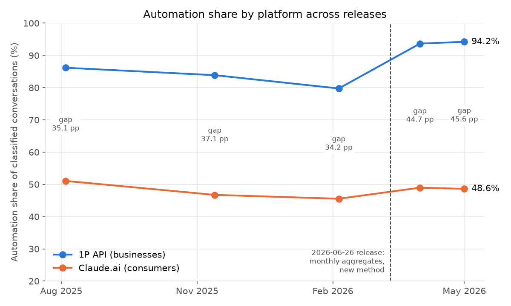
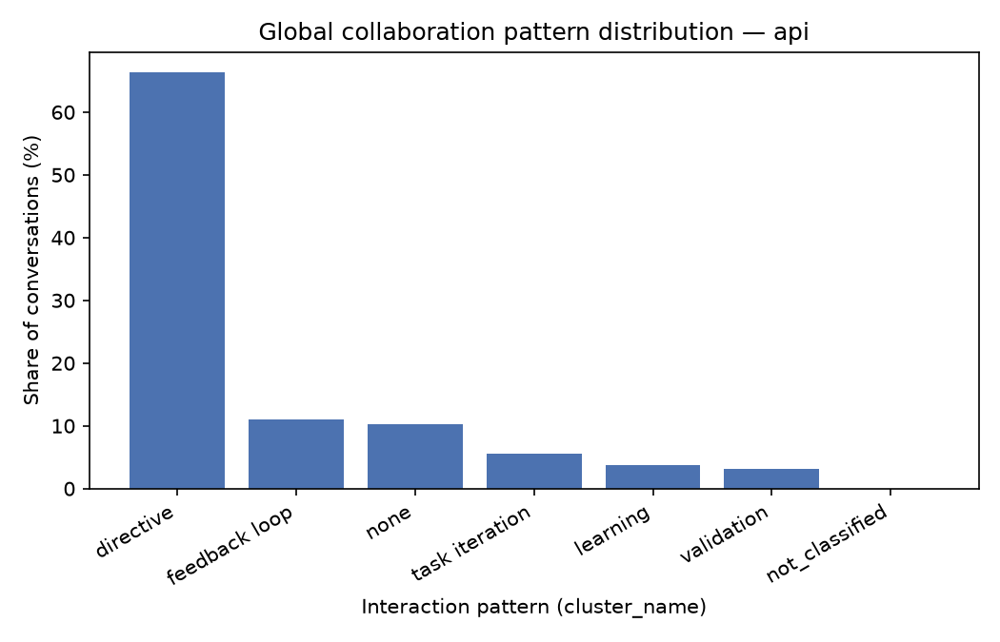
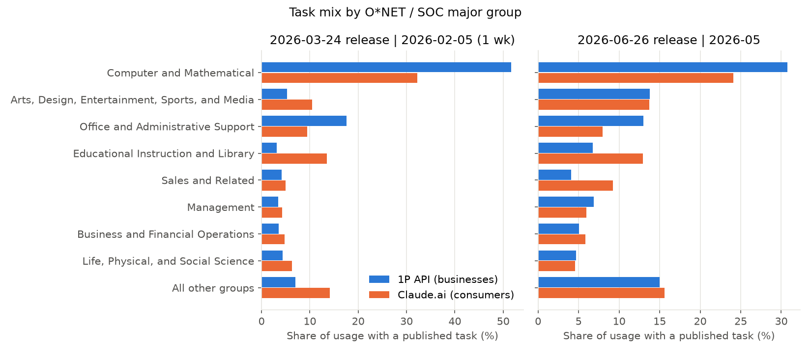
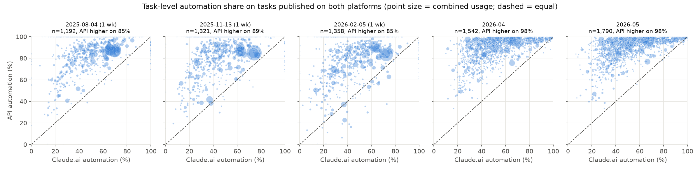
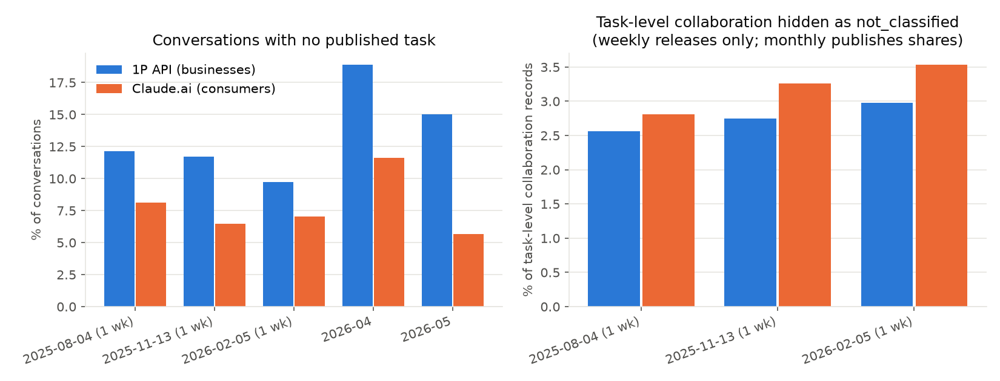

# Exploratory Profile

**Research question:** Do businesses (API usage) show a higher automation share than individual consumers (Claude.ai usage) on the same tasks, and has that gap changed across the Anthropic Economic Index's releases?

**Data:** four releases, 2025-09-15 to 2026-06-26, giving five periods per platform:
- three one-week samples: Aug 2025, Nov 2025, Feb 2026;
- two calendar months: Apr and May 2026.

Every number comes from `src/inventory.py` or `src/exploratory.py`. Every figure comes from `src/exploratory.py`. Provenance, verification and the harmonization table are in `NOTES.md`.

## Definitions, reproduction and uncertainty

**Two definitions of automation share.** Every number below says which one it uses.

| Name | Formula | Used by |
|:--|:--|:--|
| **All** | (directive + feedback loop) / all conversations, including "none" | Anthropic's reports |
| **Classified** | (directive + feedback loop) / (all five patterns) | This profile, for comparisons |

The classified definition is used for comparisons because the API's "none" share moves between 5.5% and 15.2% across releases. Under the "all" definition, that movement would shift the automation share with no change in behavior.

Example, Aug 2025 Claude.ai: 49.10% under **all** (the report's 49.1%) but 51.07% under **classified**.

**Reproduction.** Using the reports' definition, the data reproduces the headline numbers:
- Aug 2025: API 77.37% (report: 77%) and Claude.ai 49.10% (report: 49.1%).
- 11 further report claims also match within 0.5 pp, plus both directional claims. See `NOTES.md` §5, Claimed vs. actual.

**Uncertainty: method matters, sampling doesn't.**
- **Sampling error is negligible.** With ~1M records per platform per week, the 95% binomial interval on any automation share is at most ±0.1 pp (0.07–0.10 pp; `inventory.py`). Even this is optimistic for the API, where records cluster within customers, but it is far below the differences discussed here.
- **Method changes are the real uncertainty:**
  - a different classifying model in each release;
  - Claude Code in and then out of the API sample;
  - weekly samples replaced by monthly totals;
  - a new O*NET version;
  - privacy suppression that differs by platform.

  Each of these can move a share by several points. Differences are treated as trustworthy only *within* a regime (the three weekly releases, or the monthly release).

## 1. Automation share by platform (outcome variable)

| Release | Period | API, classified (%) | Claude.ai, classified (%) | Gap (pp) | API, all (%) | Claude.ai, all (%) |
|:--|:--|--:|--:|--:|--:|--:|
| 2025-09-15 | Aug 4–11, 2025 | 86.17 | 51.07 | 35.10 | 77.37 | 49.10 |
| 2026-01-15 | Nov 13–20, 2025 | 83.87 | 46.74 | 37.13 | 74.61 | 45.36 |
| 2026-03-24 | Feb 5–12, 2026 | 79.75 | 45.55 | 34.20 | 67.63 | 44.16 |
| 2026-06-26 | Apr 2026 | 93.67 | 48.98 | 44.69 | 88.29 | 47.72 |
| 2026-06-26 | May 2026 | 94.21 | 48.62 | 45.59 | 89.03 | 47.35 |

*Figure 1. Automation share of classified conversations, API vs. Claude.ai, for each period. Gap labels are API minus Claude.ai in percentage points. The dashed line marks the switch from weekly samples to monthly totals, which also removed Claude Code from the API and added Cowork to Claude.ai. Source: `src/exploratory.py`, `plot_automation_gap_over_time`.*

- **The API is more automated in every period**, by 34–46 pp.
- **Weekly regime:** the gap is roughly flat (35.1 → 37.1 → 34.2 pp) while both platforms drift toward augmentation (API −6.4 pp, Claude.ai −5.5 pp, Aug 2025 → Feb 2026). The 2026-03-24 report says its API sample includes Claude Code, which had become a large share of traffic. So the API's drift may partly reflect Claude Code's growth rather than a change in how businesses work.
- **Monthly regime:** the gap is ~45 pp and stable (44.7 → 45.6). The ~10 pp jump between regimes comes almost entirely from the API (79.8% → 93.7%), in the same release that removed Claude Code from the API sample. It should be read as a change in which conversations are sampled, not a trend.

## 2. Collaboration pattern mix

Share of **all** conversations (%). The raw files' <0.01% not_classified bucket is left out.

| Platform | Period | Directive | Feedback loop | Task iteration | Learning | Validation | None |
|:--|:--|--:|--:|--:|--:|--:|--:|
| API | Aug 2025 | 66.30 | 11.08 | 5.50 | 3.78 | 3.14 | 10.21 |
| API | Nov 2025 | 63.58 | 11.02 | 5.85 | 4.19 | 4.31 | 11.04 |
| API | Feb 2026 | 58.22 | 9.41 | 9.30 | 4.43 | 3.45 | 15.19 |
| API | Apr 2026 | 80.88 | 7.41 | 2.90 | 1.47 | 1.60 | 5.73 |
| API | May 2026 | 82.75 | 6.28 | 2.68 | 1.38 | 1.41 | 5.51 |
| Claude.ai | Aug 2025 | 38.78 | 10.32 | 22.22 | 20.34 | 4.48 | 3.86 |
| Claude.ai | Nov 2025 | 31.73 | 13.63 | 27.20 | 19.72 | 4.77 | 2.96 |
| Claude.ai | Feb 2026 | 32.64 | 11.52 | 25.58 | 22.35 | 4.86 | 3.05 |
| Claude.ai | Apr 2026 | 31.72 | 16.00 | 29.88 | 16.75 | 3.08 | 2.58 |
| Claude.ai | May 2026 | 31.38 | 15.97 | 30.41 | 16.55 | 3.08 | 2.61 |

*Figure 2. The five collaboration patterns plus "none", stacked to 100%, for each platform and period. Directive and feedback loop are the automation patterns. Source: `src/exploratory.py`, `plot_collaboration_distribution`.*

- **The API gap is mostly directive use.** Directive is 58–83% of all API conversations against ~31–39% on Claude.ai. Feedback loop is similar on both platforms (6–16%).
- **The biggest single move on Claude.ai is the directive drop from Aug to Nov 2025** (38.8% → 31.7%, −7.1 pp), which the 2026-01-15 report also states ("fell 7pp to 32%"). Since then directive has been flat at ~31–33%. What still moves is learning (22.4% → 16.6%) against feedback loop and task iteration.
- **On the API, the second-largest mover is "none"**, which halves at the monthly boundary (15.2% → 5.5%) at the same time directive jumps. That fits a change in what the API sample contains.

## 3. Task mix by platform

Usage share by SOC major group. Shares are renormalized over tasks with a published share, so each period sums to 100.

| Period | API: Computer & Math | Claude.ai: Computer & Math | API: Office & Admin Support | Claude.ai: Education & Library |
|:--|--:|--:|--:|--:|
| Aug 2025 | 49.98 | 39.03 | 11.08 | 13.45 |
| Nov 2025 | 51.73 | 36.02 | 15.14 | 16.24 |
| Feb 2026 | 51.61 | 32.23 | 17.56 | 13.48 |
| Apr 2026 | 30.82 | 25.32 | 12.75 | 12.57 |
| May 2026 | 30.77 | 24.10 | 13.02 | 12.95 |

*Figure 3. Usage share by SOC major group for the last weekly period (Feb 2026) and the last month (May 2026): top 8 groups, the rest pooled. Mapping differs by regime:*
- *Weekly releases: each task statement is mapped to its major group with the O\*NET reference file (`onet_task_statements_raw.xlsx`), splitting a statement shared by several groups equally. 100% of tasks matched.*
- *Monthly release: its own `soc_occupation` major-group rows.*

*Source: `src/exploratory.py`, `plot_task_mix`; mapping in `src/releases.py`, `major_group_mix`.*

- **The API is concentrated in software work.** Computer & Mathematical is half of API usage in the weekly releases, against roughly a third of Claude.ai. Office & Admin Support is the API's second group; Education is Claude.ai's.
- **The API's Computer & Mathematical share falls from 51.6% to 30.8%** at the monthly boundary, consistent with Claude Code being removed. Claude.ai falls less (32.2% → 24.1%).
- **Task mix alone could produce part of the overall gap**, because coding is delegated more than education or advising. Section 4 tests this.

## 4. Same-task comparison

For each task published on both platforms in the same period, automation share is computed per task (classified definition, excluding the task's own none and not_classified).

| Period | Shared tasks | API-only | Claude.ai-only | Tasks where API is higher (%) | Usage where API is higher (%) | Usage-weighted gap (pp) | Median gap (pp) |
|:--|--:|--:|--:|--:|--:|--:|--:|
| Aug 2025 | 1,192 | 552 | 615 | 85.5 | 97.5 | 29.0 | 39.9 |
| Nov 2025 | 1,321 | 593 | 766 | 88.9 | 98.0 | 30.2 | 45.5 |
| Feb 2026 | 1,358 | 539 | 842 | 84.8 | 92.7 | 27.7 | 41.6 |
| Apr 2026 | 1,542 | 421 | 838 | 98.3 | 99.1 | 36.4 | 37.8 |
| May 2026 | 1,790 | 472 | 901 | 97.9 | 99.6 | 36.9 | 38.7 |

*Figure 4. Task-level automation share on Claude.ai (x) vs. the API (y), for tasks published on both platforms, one panel per period. Point size = combined usage share; dashed line = equal automation. Points above the line are tasks where businesses automate more. Source: `src/exploratory.py`, `plot_task_automation_scatter` and `same_task_stats`.*

- **On the same task, the API is more automated almost everywhere:**
  - 85–89% of shared tasks in the weekly releases and ~98% in the monthly release;
  - covering 92.7–99.6% of usage.
- **Most of the gap is not task mix.** The usage-weighted gap *within* tasks (28–30 pp weekly, ~37 pp monthly) is most of the overall gap (34–37 pp weekly, ~45 pp monthly). This is a first look, not the decomposition: the weighting differs, and per-task automation leaves out not_classified records.
- **Small cells are noisy.** In the weekly releases many points sit at exactly 0% or 100%. These are small tasks with only a few classified records, because patterns below the privacy threshold go into not_classified. Weighting by usage limits their influence.

## 5. Missing and hidden data

*Figure 5. Left: share of conversations with no published task (raw "none" + not_classified task rows; monthly: 100 minus the published task shares). Right: share of task-level collaboration records hidden as not_classified (weekly releases only; the monthly release publishes no counts). Source: `src/exploratory.py`, `plot_unpublished`.*

- **The API has more conversations with no published task than Claude.ai** in every period: 9.7–12.2% vs. 6.5–8.1% weekly, and 15.0–18.9% vs. 5.7–11.6% monthly. Task-level results describe a slightly less complete picture of API usage.
- **Hidden collaboration detail is small (2.6–3.5%) and slightly higher on Claude.ai.** Hiding is not random: it removes small cells, i.e. rare patterns within rare tasks.
- **April 2026 has the most unpublished task usage** on both platforms (18.9% API, 11.6% Claude.ai), much more than May. That suggests the first monthly period had more cells below the thresholds.

## 6. Anomalies and modeling implications

- **Two regimes.** The 2026-06-26 release changes the sampling method, the coverage (Claude Code out, Cowork in), the classifier setup and the task taxonomy all at once. Model it as a separate regime, e.g. with a release-format indicator. Compare trends only within the weekly releases (gap 35.1 → 37.1 → 34.2 pp) or within the monthly release (44.7 → 45.6 pp).
- **Measurement asymmetry.** An API record is a single prompt–response pair; a Claude.ai record is a whole conversation. Iteration-type patterns are structurally harder to observe on the API, so part of the gap may be mechanical. The editing-task example in `NOTES.md` §8 shows a ~50 pp gap on one task. Directive and feedback loop should be compared separately.
- **Geography is out of scope.** API data is global-only in every release, so geography cannot explain the API vs. Claude.ai gap.
- **Few time points.** Five periods per platform, three in one regime and two in the other, so any trend claim rests on very few observations.
